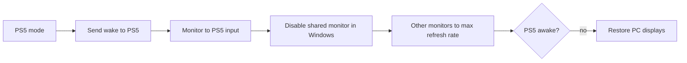

# PS5 / PC One-Click Switch

Share one monitor between your Windows PC and a PS5, and switch between them with one click, or automatically when the PS5 turns on or goes to Rest Mode.

**PS5 mode:** wakes the PS5, switches the shared monitor to the PS5's input, and moves Windows onto your other monitor(s).
**PC mode:** puts the PS5 in Rest Mode, brings the shared monitor back into Windows, and switches it back to the PC's input.

No streaming and no capture card: the PS5 stays plugged straight into the monitor. The PC just tells the monitor which input to show (over DDC/CI), rearranges Windows' displays, and talks to the PS5 over your home network.

## What you need

- Windows 10 or 11
- A **shared monitor** connected to both the PC and the PS5, with **DDC/CI turned on** in its on-screen menu
- At least one **other monitor** connected only to the PC (Windows moves there in PS5 mode)
- A PS5 on the same home network as the PC
- [Python 3](https://www.python.org/downloads/) (tick *Add Python to PATH* when installing)

## Setup

1. **On the PS5**
   - Settings > System > Remote Play > **Enable Remote Play**
   - Settings > System > Power Saving > Features Available in Rest Mode > turn on **Stay Connected to the Internet** and **Enable Turning On PS5 from Network**
   - Keep the PS5 **on** for the first setup (needed once, to pair)
2. **Download** this repository (green *Code* button > *Download ZIP*) and extract it somewhere permanent, for example `Documents\PS5_PC_OneClick_Switch`.
3. **Run the installer:** right-click `Install.ps1` > *Run with PowerShell*.
   If Windows blocks it, open PowerShell in the folder and run:
   ```powershell
   powershell -ExecutionPolicy Bypass -File .\Install.ps1
   ```
4. Follow the 8 steps. The installer:
   - downloads two small monitor tools from [NirSoft](https://www.nirsoft.net) and installs [ps5-remoteplay](https://pypi.org/project/ps5-remoteplay/)
   - finds your PS5 on the network and pairs with it (once: PlayStation sign-in in your browser, then a PIN from the PS5)
   - lets you pick the shared monitor from a list and detects its PC and PS5 inputs
   - saves your normal display layout and creates the PS5 layout automatically
   - asks which automatic switches you want, creates desktop shortcuts, and builds and starts the tray app (compiled on your PC from `Tray.cs` with the C# compiler built into Windows; no download)

Tip: give the PS5 a fixed IP in your router (DHCP reservation) so it's always found.

## Using it

The **tray icon** near the clock shows the current mode: **PC** (green), **PS5** (blue), or **...** (orange) while switching. It may be hidden under the `^` arrow; drag it onto the taskbar to keep it visible.

- **Double-click** the icon to toggle between modes.
- **Right-click** for the menu:

| Menu item | What it does |
|---|---|
| Switch to PS5 mode / PC mode | Switch now |
| Switch to PS5 mode when the PS5 turns on | Turning the PS5 on with the controller switches the monitor to it |
| Switch to PC mode when the PS5 goes to Rest Mode | Putting the PS5 to sleep switches the monitor back to the PC |
| Start with Windows | Start the tray app at sign-in (needed for automatic switching) |
| Open log / Run diagnostics | Help when something goes wrong |

The optional desktop shortcuts **PS5 MODE**, **PC MODE** and **PS5-PC TOGGLE** do the same without the tray.

If a switch fails, a message box explains why. If the PS5 doesn't wake, your PC displays are restored automatically.

## How it works



- **Monitor input:** DDC/CI VCP code `60` (Input Select), via NirSoft ControlMyMonitor. The monitor is addressed by its EDID *Short Monitor ID* (for example `AOCA615`), which stays the same no matter which monitor is Windows' primary.
- **Windows layout:** NirSoft MultiMonitorTool saves and loads layouts. Re-enabling the shared monitor uses Windows' own `DisplaySwitch /extend`, because MultiMonitorTool can't re-enable a disabled monitor on current Windows 11 builds.
- **PS5:** [ps5-remoteplay](https://github.com/iharosi/ps5-remoteplay) wakes the PS5 and puts it in Rest Mode. The tray watches the PS5's status by asking it on the network twice per second (UDP port 9302).
- **Tray app:** a small C# program (`Tray.cs`, built into `PS5PCSwitch.exe` by the installer). It only watches and launches; the switches run in PowerShell and exit when done. Idle it uses about 35 MB of RAM and no measurable CPU.
- **Speed:** the PS5 boots while the displays switch, so PS5 mode takes about as long as the PS5 itself needs to wake (~10 s). PC mode keeps the monitor on the PS5 for a moment so you see its shutdown screen, then switches back (~10 s including Rest Mode).

## Settings

Everything lives in `config.json` (created by the installer; see `config.example.json`). Most settings can be changed from the tray menu or by re-running the installer.

| Setting | Meaning |
|---|---|
| `PS5IP` | The PS5's IP address |
| `PS5Passcode` | Your PS5 login passcode, if you have one (needed to put the PS5 in Rest Mode) |
| `Monitor` | Short Monitor ID of the shared monitor |
| `PCInput`, `PS5Input` | The monitor's VCP 60 input values for the PC and the PS5 |
| `AutoPS5OnWake` | Switch to PS5 mode when the PS5 turns on (`true`/`false`) |
| `AutoPCOnStandby` | Switch to PC mode when the PS5 goes to Rest Mode (`true`/`false`) |
| `StandbyAnimationMs` | How long (ms) the monitor stays on the PS5's shutdown screen before switching back; `0` = immediately |

`config.json` contains your PS5 passcode and is excluded from git by `.gitignore`.

## Troubleshooting

Run **Run diagnostics** from the tray menu (or `Diagnostics.ps1`) first. It shows the PS5 status, every monitor, the shared monitor's current input, and the recent log.

| Problem | Fix |
|---|---|
| Monitor input doesn't change | Turn on DDC/CI in the monitor's menu. Check that diagnostics shows a value for *VCP 60*. Some AMD driver versions have had DDC/CI bugs. |
| "PS5 not found" | The PS5 must be in Rest Mode, not fully off, and on the same network. Check its IP (it may have changed; reserve it in your router). |
| PS5 won't go to Rest Mode: "requires a passcode" | Add your PS5 login passcode as `PS5Passcode` in `config.json`, or re-run the installer. |
| PS5 won't go to Rest Mode: "another Remote Play session is already using this pairing" | Close the PS Remote Play app on other devices and try again. |
| The shared monitor doesn't come back into Windows | Press Win+P > Extend. Then re-run the installer to save your layout again. |
| Wrong layout after PC mode | You changed your monitor arrangement: re-run the installer (or tray > Exit, then `Tools\MultiMonitorTool.exe /SaveConfig pc-layout.cfg`). |
| Nothing happens automatically | The tray app must be running (tray icon visible), and the automatic options must be ticked in its menu. |

## Uninstall

Right-click `Uninstall.ps1` > *Run with PowerShell*. It stops the tray app, removes autostart and desktop shortcuts, and optionally deletes your settings.

## Files

| File | Purpose |
|---|---|
| `Install.ps1` / `Uninstall.ps1` | Guided setup / removal |
| `Tray.cs` | Tray app source: menu, status, automatic switching (built into `PS5PCSwitch.exe` on install) |
| `PS5-Mode.ps1`, `PC-Mode.ps1`, `Toggle.ps1` | The switches (used by the tray and the desktop shortcuts) |
| `Common.ps1` | Shared logic |
| `DisplayModes.cs` | Sets monitors to their highest refresh rate (Windows can drop them to 60 Hz) |
| `Diagnostics.ps1` | Status report |

## Credits

- [ps5-remoteplay](https://github.com/iharosi/ps5-remoteplay) (AGPL-3.0), used as a separate program, installed from PyPI
- [ControlMyMonitor](https://www.nirsoft.net/utils/control_my_monitor.html) and [MultiMonitorTool](https://www.nirsoft.net/utils/multi_monitor_tool.html) by NirSoft (freeware), downloaded by the installer

Not affiliated with Sony or PlayStation.

## License

[MIT](LICENSE)
